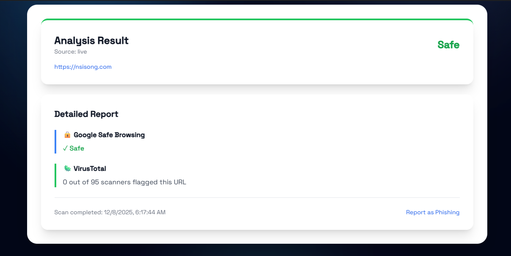
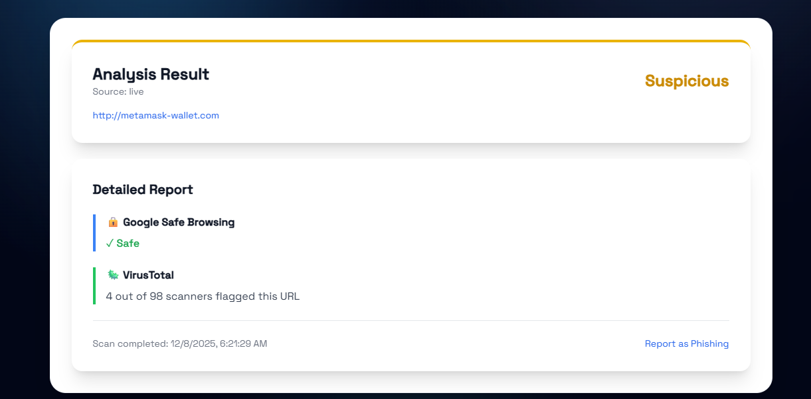
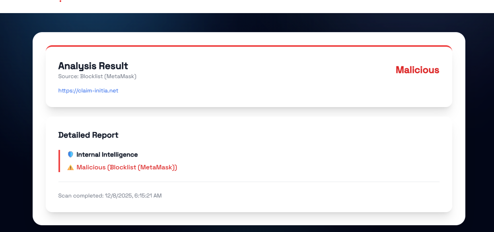

> **Licensing update (31 October 2026):** The current policy requires prior written permission for reuse and a separate agreement for AI training. See [LICENSE](LICENSE). Earlier grants remain valid for previously licensed material; [LICENSE.previous](LICENSE.previous) preserves those terms. Any older license descriptions below describe the previous policy. Contact [ei@nsisong.com](mailto:ei@nsisong.com).

# PhishFinder

> **Stop phishing links before they land. One scan. Clear verdict.**

An efficient URL threat analysis service that scans links through multiple security engines to detect phishing and malicious content. Built with Next.js, TypeScript, and MongoDB.

## What It Does

PhishFinder provides real-time URL analysis by checking against:
- **Google Safe Browsing API** - Industry-standard threat detection
- **VirusTotal** - Multi-engine security scanning
- **Internal Blocklists** - Aggregated from MetaMask, OpenPhish, PhishFort, URLHaus, and more
- **24h Caching** - Fast repeat checks with automatic refresh

## Visual Showcase

### Safe URL Detection
When a URL passes all security checks, you get a clear **Safe** verdict with detailed reports.

### Suspicious URL Detection
URLs with some security concerns (1-5 VirusTotal positives) are flagged as **Suspicious** for your review.

### Malicious URL Detection
Known phishing and malicious domains are immediately flagged as **Malicious** from our aggregated blocklists.

---

## How it moves

- **Fast Analysis** - Multi-source checks in seconds
- **Comprehensive Coverage** - 73,827+ malicious domains in blocklist
- **Smart Caching** - 24-hour cache with on-demand refresh
- **Privacy First** - No secrets stored, open-source code
- **Detailed Reports** - See exactly why a URL is flagged
- **Modern UI** - Clean, responsive design with dark theme 

## What I would do later

- Search counter to show total scans performed
- User submission system for phishing reports
- ML model integration using [PhiUSiil dataset](https://archive.ics.uci.edu/dataset/967/phiusiil+phishing+url+dataset)
- Email content analysis for phishing detection
- Webpage feature extraction and analysis

## Resources I tap from

- [PhishTank](https://www.phishtank.com/) - Community phishing database
- [PhiUSiil Dataset](https://archive.ics.uci.edu/dataset/967/phiusiil+phishing+url+dataset) - Phishing URL dataset for ML training

---

**You can use it via**: [phishfinder.pro](https://www.phishfinder.pro)

## Current Coverage

**Total malicious domains: 73,827**

The aggregated blocklist includes:
- **MetaMask**: 73,620 domains (crypto phishing protection)
- **OpenPhish**: 207 domains (general phishing threats)
- **PhishFort**: 2 domains (additional security sources)
- **URLHaus**: Active malware domain tracking
- **More sources** updated via automated cron jobs

## Built this version with

- **Frontend**: Next.js 14, React, TypeScript, Tailwind CSS
- **Backend**: Next.js API Routes
- **Database**: MongoDB (caching & blocklist storage)
- **APIs**: Google Safe Browsing, VirusTotal
- **Deployment**: Vercel
- Archived the initial Python version from 2023

## Project Notes

> i intended to use nlp to analyze URLs, email content, and webpage features to determine if a link or message is a phishing attempt. i might also build a classification model using labeled data from phishing and legitimate sites that i will gather too. But right now, I just ended up building an efficient URL threat analysis service that scans links through multiple security engines to detect phishing and malicious content.

> initially i was thinking i will find one pre-set dataset on kaggle to use that has legit and phishing separately. but clearly right now i found something else the PhiUSiil dataset. Will use that, so i will adjust the data preprocessing script.

> i tried to run the script without training the model with the dataset, so i am going to train it first. fuck me for not remembering.

> i am thinking on the website where people would do phishing websites search, i will probably add a counter to show how many searches has been found.

> i also think i should have a way for people to add to the phishing list for my model to validate too, and train with. like a submit phishing site button.
